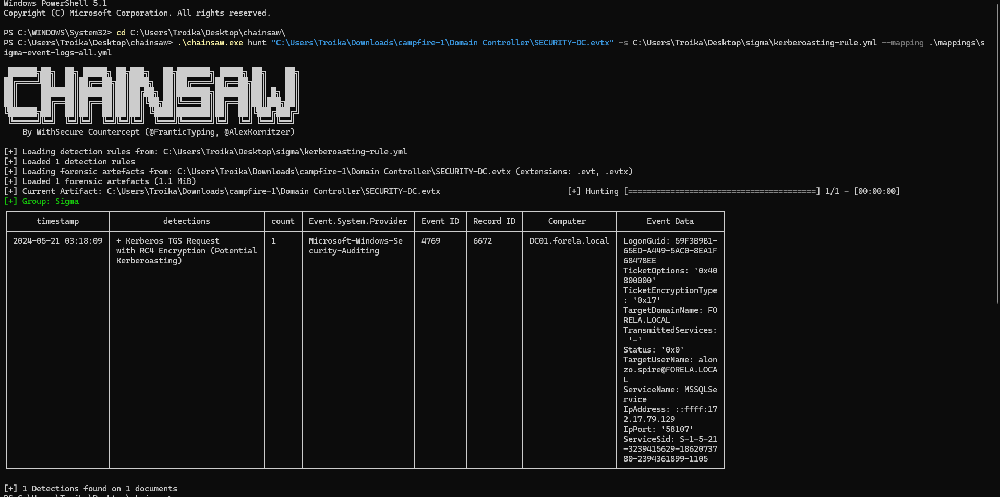

# Campfire-1: Kerberoasting Detection with Sigma

## Lab Overview

This Sherlock provides several investigative pivots that reveal how the attacker
performed Active Directory reconnaissance and then targeted service accounts
for credential theft.


The investigation  revealed a **Kerberoasting** attack
(MITRE ATT&CK [T1558.003](https://attack.mitre.org/techniques/T1558/003/)).
On the Domain Controller, the Security log shows a Kerberos service ticket request
(Event ID 4769) with the following characteristics:

- Ticket encryption type **RC4 (0x17)**, which is faster to crack offline than AES
- Status `0x0`, meaning the ticket was issued successfully

Using the attack behavior and the provided Windows event logs as investigative
references, I developed a **Sigma detection rule** designed to identify Kerberos
service ticket requests that use RC4 encryption.

The goal of this rule is to help detect potential Kerberoasting activity, where an
attacker requests service tickets for accounts with an SPN in order to crack their
passwords offline.

## Detection Logic

| Field | Value |
|---|---|
| Log source | Windows Security |
| Event ID | 4769 |
| Condition | `TicketEncryptionType = 0x17` |
| Level | Low |

Rule file: [`kerberoasting-rule.yml`](kerberoasting-rule.yml)

## Validation

The rule was tested against the Domain Controller log provided with the Sherlock
(`SECURITY-DC.evtx`) using [Chainsaw](https://github.com/WithSecureLabs/chainsaw)
with the Sigma event logs mapping:

```powershell
.\chainsaw.exe hunt "<path>\Domain Controller\SECURITY-DC.evtx" `
  -s .\kerberoasting-rule.yml `
  --mapping .\mappings\sigma-event-logs-all.yml
```

**Result:** 1 detection found on 1 document, matching the Kerberoasting event
described above (DC01.forela.local, Record ID 6672, 2024-05-21 03:18:09).



## Limitations

- Detects RC4 only. An attacker who requests AES tickets will not be caught.
- Legacy systems, old service accounts, or GPOs that allow RC4 can generate
  legitimate events with `0x17`.
- A single event is weak evidence. A stronger behavioral detection is one account
  requesting tickets for several different SPNs in a short time.


