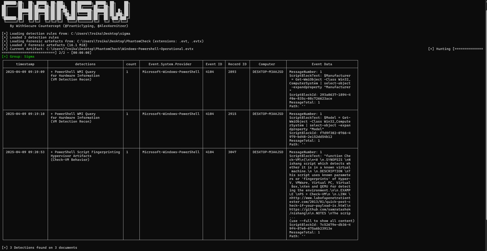

I tested both rules against PowerShell Operational logs (Event ID 4104) using [Chainsaw](https://github.com/WithSecureLabs/chainsaw):
```chainsaw hunt <logs_path> -s <rules_path> --mapping mappings/sigma-event-logs-all.yml```
   
